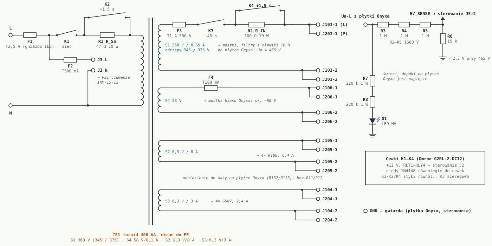
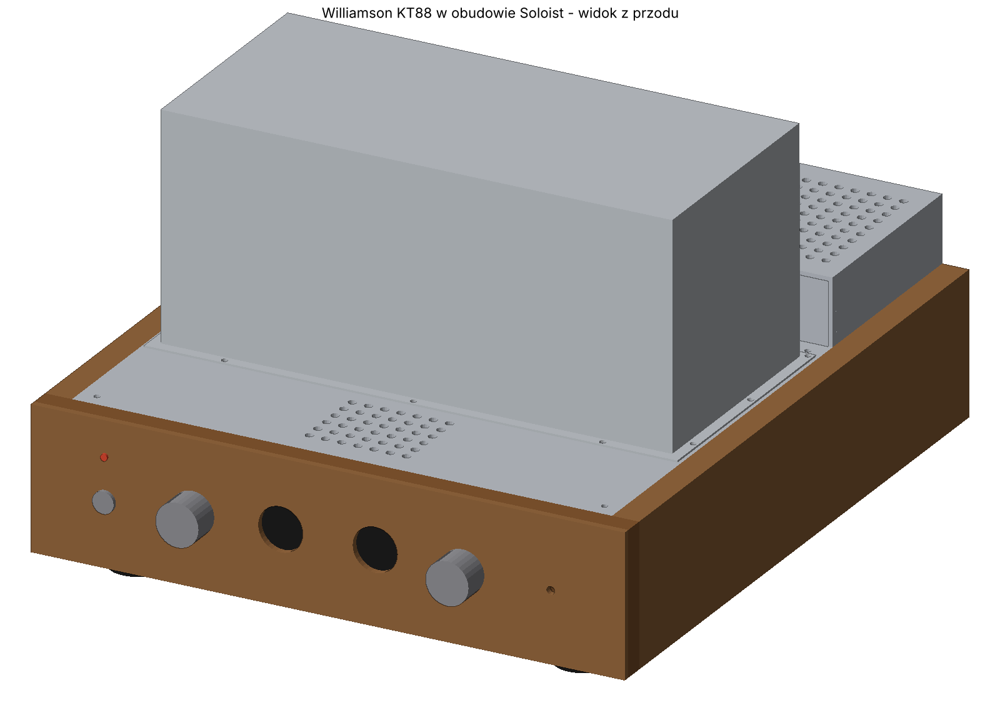

# Williamson KT88

Lampowy wzmacniacz push-pull w klasycznej topologii Williamsona (wszystkie lampy sterujące na 6SN7), z końcówką na parze KT88 w układzie ultralinearnym (UL). Projekt to wzmacniacz **onyx1944** na jego płytce VA1523:

- wersja na KT88 (zdjęcia, PCB): https://onyx1944.wordpress.com/2023/11/21/williamson-kt88/
- wersja na 6S33S (schemat i zasilacz): https://onyx1944.wordpress.com/2020/03/16/6s33s-williamson-amplifier/

Płytka **VA1523-V1.0** jest kupiona od Onyxa (bez lamp i transformatorów), a Onyx udostępnił schematy. Schemat w tym repozytorium jest przerysowany z jego schematu i **poprawiony według wartości faktycznie wlutowanych na płytce**. Pomarańczowe elementy to te, które trzeba sprawdzić albo dobrać pod toroid TTG-KT88PP i własny transformator sieciowy. Oryginalnych plików Onyxa tu nie ma, to jego praca.

> **Status: płytka w ręku, przed uruchomieniem.** Punkty pracy są szacunkowe (model lampy, Ua ≈ 465 V), do potwierdzenia pomiarem.

> ⚠️ **Wysokie napięcie.** Ua ok. 465 V, a na zimno i przy wysokim napięciu sieci więcej. Kondensatory filtrów rozładowują się przez rezystory 560 k i dzielnik żarzenia; to trwa od kilkudziesięciu sekund do kilku minut. Przed dotknięciem płytki zawsze zmierz napięcie.

## Schematy

| Plik | Zawartość |
|---|---|
| [`schematy/kanal.svg`](schematy/kanal.svg) | Jeden kanał wg VA1523: 6SN7 (wejście + katodyna) → 6SN7 (driver) → 2× KT88 UL, bias osobno dla każdej lampy |
| [`schematy/zasilacz.svg`](schematy/zasilacz.svg) | Zasilacz z płytki (osobno w każdym kanale): mostek, CLC z dławikiem 10 H, Uaa przez R128, bias, podniesienie żarzenia |
| [`schematy/plytka_zasilacza.svg`](schematy/plytka_zasilacza.svg) | Własna płytka zasilacza: bezpieczniki, miękki start K1/K2, opóźnione anody K3/K4 z R_IN, napięcia przemienne do płytki Onyxa, pomiar Ua i dioda HV |
| [`schematy/williamson-kt88.html`](schematy/williamson-kt88.html) | Oba schematy z punktami pracy, różnicami płytka/schemat, listą zmian i uruchomieniem (otwórz w przeglądarce) |




## Najważniejsze dane

| | Wartość |
|---|---|
| Lampy | V1, V2: 6SN7 (6N8S); V5, V6: KT88 (lewy kanał; prawy V3, V4, V7, V8) |
| Front end | wejście ok. 4,3 mA / 95 V, katodyna 22k/22k ok. 4,5 mA, driver ok. 5 mA na triodę (bez balansu AC) |
| Końcówka | KT88 UL, Ua ≈ 465 V, 50–55 mA (0,50–0,55 V na 10 Ω), Ug1 ≈ −45…−55 V |
| Transformator wyjściowy | toroidy.pl **TTG-KT88PP** (u Onyxa Hammond 1650HA 6,6 kΩ) |
| Sprzężenie zwrotne | R129 15k z **odczepu 8 Ω** (ok. 12 dB), C123 niemontowany |
| Czułość / moc | ok. 0,65 V / ok. 40 W na kanał, kolumny na odczepie 4 Ω |
| Transformator sieciowy | 400 VA: 360 V (odczepy 345/375 V)/0,65 A, 58 V/100 mA, 6,3 V/8 A, 6,3 V/3 A, ekran ([docs/08](docs/08-zamowienie-toroidy.md)) |
| Dławiki | 2× 10 H na L106 / L206, min. 200 mA, DCR < 100 Ω |

## Płytka a schemat Onyxa

| Element | Na schemacie | Na płytce |
|---|---|---|
| R117 / R217 | 220k / 1k | **100k / 100k** |
| R124 / R224 | 10 Ω / 470k | **10 Ω / 10 Ω** |
| C123 / C223 | 56 pF | **brak** |
| R101 | 1M | **220k** |
| R103 | 47k | **33k** |
| R104 / C102 | 47 Ω / 47 µF | **zwora / brak** |
| R111, R112 | 470k | **300k** |
| R119, R120 | 470k | **68k** |
| P101, P102 | 47k | **20k** |
| R139, R140 | 47k | **4k7** |
| R129 | 22k | **15k** |
| R134 | 10 Ω | **5,1 Ω** |
| R136 / R137 | 100k / 10k | **brak** w lewym, **300k / 68k** w prawym |
| R130–R133 | 330 Ω | **390 Ω** |
| R143–R152 | 680k | **560k** |
| R125, R126 | 100 Ω | odczytano 150k – **do sprawdzenia** (pewnie 150 Ω) |
| R141, R142 | 10 Ω / 100 Ω | odczytano 47k – **do sprawdzenia** |

## Zasilacz, sterowanie, dodatki i obudowa

Płytka Onyxa dostaje własną, prostą płytkę zasilacza (bez prostowników i filtrów, bo te są na płytce Onyxa): miękki start, opóźnione anody, pomiar Ua. Z [Soloist-KT88](https://github.com/sieraczynski-lab/Soloist-KT88) bierze sterownik ESP32 z automatyczną korektą biasu, przełącznik UL / trioda, przełącznik kolumn z triggerem, selektor z drabinką głośności i obudowę. Te płytki Soloista bez zmian w PCB, płytka Onyxa bez cięcia ścieżek. Szczegóły: [docs/09-integracja-soloist.md](docs/09-integracja-soloist.md), obudowa: [`obudowa/`](obudowa/).



## Decyzje i otwarte sprawy

- **Toroid TTG-KT88PP** zamiast Hammonda: sprzężenie zwrotne z odczepu 8 Ω (zbliżona głębokość pętli jak u Onyxa), kolumny na 4 Ω. Kompensację C123 dobrać na oscyloskopie, jeśli prostokąt dzwoni.
- **R128 / R228** (4k7) dobrać do własnego Ua, żeby Uaa wyszło ok. 380–420 V.
- **Driver bez balansu AC:** do V2 dawać 6SN7 o zbliżonych prądach obu triod.
- **Dodatek:** rezystor 100 Ω / 2 W między 4 Ω a COM (wzmacniacz nie pracuje bez obciążenia).
- **Odpowiedzi Onyxa (12.11.2026):** u niego TR1 to toroidy.pl TSTA-0300/001 (300 VA), radzi większy, więc 400 VA jest w porządku. Sprzężenie zwrotne z odczepu 8 Ω (zgodnie z planem). C123 i ewentualnie R102/C101 tylko pod prostokąt (u niego niepotrzebne). Pomyłki na schemacie potwierdzone. Szczegóły w [docs/07](docs/07-wersje-onyxa.md#odpowiedzi-onyxa-12112026).
- **Do sprawdzenia na płytce:** dokąd idzie sieć UaFF-L2 (środek żarzenia KT88).
- Projekt równoległy: [Soloist-KT88](https://github.com/sieraczynski-lab/Soloist-KT88) (Mullard: EF86 + E88CC LTP + KT88), z podobnym transformatorem sieciowym i tymi samymi toroidami.

## Notatki

1. [Lampy KT88 Psvane: serie i różnice](docs/01-lampy-kt88.md)
2. [Transformatory wyjściowe: Hammond, toroidy.pl, Ogonowski](docs/02-transformatory-wyjsciowe.md)
3. [Topologia: Williamson, Mullard 5-20, 6S33S, 6SN7](docs/03-topologia.md)
4. [Kolumny: impedancja, zwrotnica 2,5-drożna, spadek bafla](docs/04-kolumny.md)
5. [Uruchomienie krok po kroku](docs/05-uruchomienie.md)
6. [Zamawianie płytek PCB](docs/06-pcb.md)
7. [Wersje Onyxa: zdjęcia, schemat i płytka VA1523](docs/07-wersje-onyxa.md)
8. [Specyfikacja do zamówienia w toroidy.pl](docs/08-zamowienie-toroidy.md)
9. [Zasilacz, sterowanie, dodatki i obudowa](docs/09-integracja-soloist.md)

## Generowanie schematów

Schematy są rysowane skryptem (Python 3, bez dodatkowych bibliotek):

```bash
python3 narzedzia/build.py
```

Obudowa (STEP, DXF, widoki) powstaje z `python3 narzedzia/obudowa/export.py` (wymaga `numpy` i `matplotlib`).

Skrypt [`narzedzia/gen_schemat.py`](narzedzia/gen_schemat.py) zawiera geometrię i wartości elementów. Po zmianie wartości wystarczy uruchomić `build.py` ponownie, a SVG i strona HTML w `schematy/` zostaną odświeżone.
