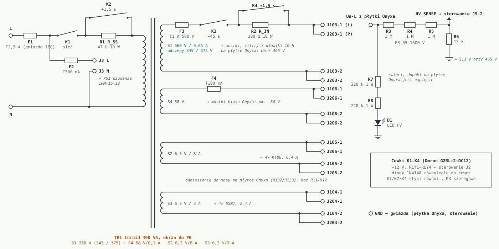
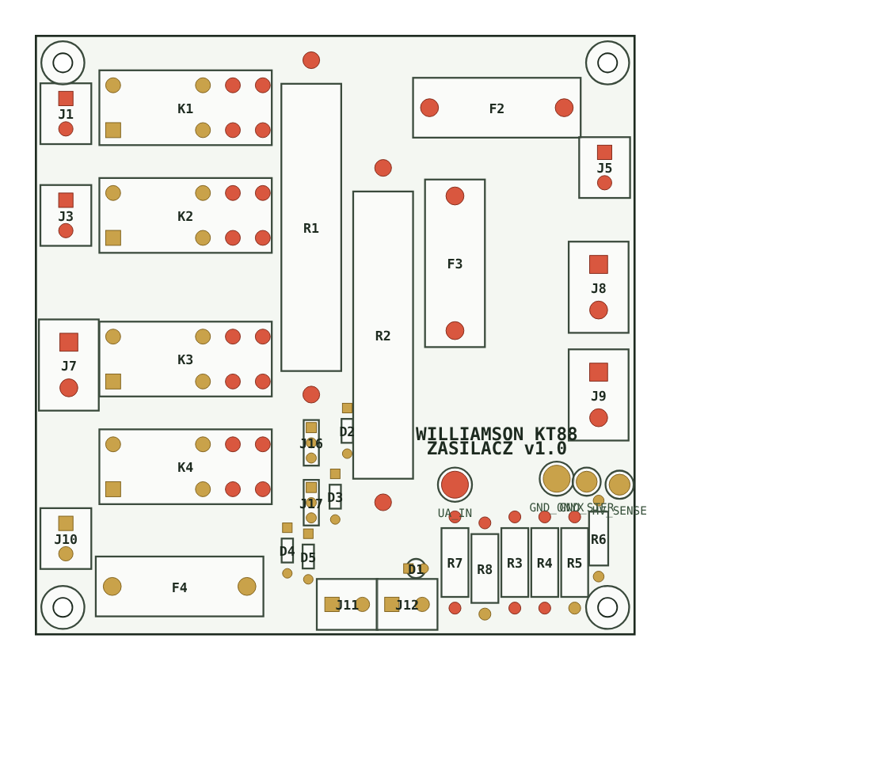
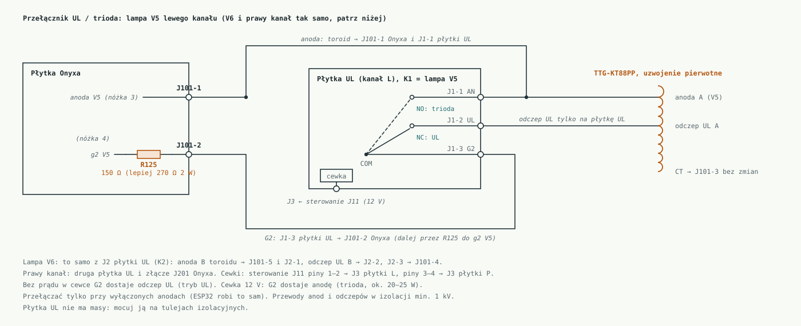

# 9. Zasilacz, sterowanie, dodatki i obudowa

Płytka Onyxa VA1523 dostaje infrastrukturę wzorowaną na projekcie [Soloist-KT88](https://github.com/sieraczynski-lab/Soloist-KT88):

- miękki start i opóźnione anody,
- sterownik ESP32 z pomiarem prądów i automatyczną korektą biasu,
- przełącznik UL / trioda,
- przełącznik kolumn z triggerem,
- selektor wejść z drabinką głośności,
- obudowę.

Zasilacz Soloista nie jest tu wzorem. Płytka Onyxa ma własne prostowniki, filtry, dławiki, prostownik biasu i podniesienie żarzenia, więc dostaje **własną, prostą płytkę zasilacza**: tylko bezpieczniki, miękki start, przekaźniki opóźniające anody, pomiar Ua i dioda HV. Bez mostków, kondensatorów i dławików. Sterowanie, UL, kolumny i selektor biorą płytki Soloista bez zmian w PCB. Na płytce Onyxa nic się nie przecina: przewody lutuje się do istniejących złączy albo nóżek elementów.

Oznaczenia elementów i złączy Soloista według jego wersji 0.23 (płytki) i 0.4 (obudowa). Oznaczenia Onyxa: lewy kanał 1xx, prawy 2xx. Schemat płytki zasilacza: [`schematy/plytka_zasilacza.svg`](../schematy/plytka_zasilacza.svg).



Projekt PCB (KiCad 4/5, import do EasyEDA, otwiera się też w KiCad 8): [`pcb/zasilacz/`](../pcb/zasilacz/), opis w [`pcb/zasilacz/CZYTAJ_MNIE.txt`](../pcb/zasilacz/CZYTAJ_MNIE.txt). Wszystkie płytki i połączenia między nimi: [`pcb/CZYTAJ_MNIE.txt`](../pcb/CZYTAJ_MNIE.txt). Płytka 100 × 100 mm, rozmieszczona, klasy sieci (szerokości i odstępy) zapisane w plikach PCB; ścieżki do poprowadzenia w EasyEDA.



## 9.1 Schemat blokowy

```
230 V ─ IEC/F1 T2,5 A ─┬─ K1 (R1 R_SS 47 Ω) → K2 (+1,5 s) ─ TR1 400 VA
                       └─ F2 T500 mA ─ PS1 IRM-15-12 (12 V czuwania dla sterowania)

S1 360 V ─ F3 T1 A ─ K3 (+45 s) ─ R2 R_IN 100 Ω → K4 (+1,5 s) ─┬─ Onyx J103 → mostek, R134, C119/120, L106 10 H, C121/122 = Ua-L ≈ 465 V
                                                               └─ Onyx J203 → to samo, Ua-P
S4 58 V ─ F4 T100 mA ──────────────────────────────────────────┬─ Onyx J106 → mostek, C125–R141/R142–C126 = Bias-L ≈ −80 V
                                                               └─ Onyx J206 → Bias-P
S2 6,3 V/8 A ──────────────────────────────────────────────────── Onyx J105 / J205 (KT88)
S3 6,3 V/3 A ──────────────────────────────────────────────────── Onyx J104 / J204 (6SN7, podniesienie z płytki Onyxa)

Ua-L ─ R3–R5 3× 1 M / R6 15 k ─ HV_SENSE → sterowanie J5-2      Ua-L ─ R7/R8 2× 220 k ─ LED HV
sterowanie (ESP32): J2 → K1–K4 · J4 ← prądy 4× KT88 · J5 ← Bias-L, Ua-L · J10 → korekta biasu 4× KT88
                    J11 → płytki UL · J13 → przełącznik kolumn · J12 ← TRIGGER · I²C → selektor
```

## 9.2 Zasilanie anodowe

Uzwojenie S1 przez F3 i styki K3 (dwa styki szeregowo, większa przerwa przy 500 V szczytowych) oraz R_IN idzie **napięciem przemiennym** na wejścia mostków Onyxa, J103 i J203 równolegle. Po 1,5 s K4 zwiera R_IN. Na płytce Onyxa wszystko zostaje jak u Onyxa: mostek UF5408, R134 10 Ω, C119/C120, **dławik na L106 / L206**, C121/C122.

| Skąd (płytka zasilacza) | Dokąd (Onyx) | Uwagi |
|---|---|---|
| za K4/R_IN | **J103 pin 1**, **J203 pin 1** | dwa przewody 0,75 mm² w izolacji 1 kV |
| drugi koniec S1 | **J103 pin 2**, **J203 pin 2** | |
| – | **L106, L206** | dwa dławiki 10 H, min. 200 mA, DCR < 100 Ω ([08](08-zamowienie-toroidy.md#3-dławiki-filtru-anodowego-2-szt)) |
| masa płytki Onyxa | gwiazda | jeden przewód 1 mm² |

**Ua:** z 360 V przy ok. 145 mA na kanał i filtrze CLC Onyxa wychodzi ok. 450–460 V. Odczepy 345 / 375 V pozwalają dobrać ok. **465 V** po pierwszym pomiarze (napięcie sieci, R_DC dławików). Uaa za R128 ok. 380 V.

**R_IN 100 Ω** ogranicza udar ładowania kondensatorów Onyxa (2× 60 µF + 2× 60 µF) do ok. 5 A; po 1,5 s K4 go zwiera.

**Masa:** sprawdź omomierzem, czy masy lewego i prawego kanału są połączone na płytce Onyxa. Jeśli tak, prowadź **jeden** przewód masy do gwiazdy. Dwa zrobiłyby pętlę masy.

**Rozładowanie:** pomiar HV_SENSE i dioda HV są podłączone do **Ua-L na płytce Onyxa** (plus C121), więc pokazują prawdziwe napięcie na kondensatorach lewego kanału. Prawy kanał rozładowuje się tak samo przez własne R236/R237 i rezystory wyrównujące; stała czasowa ok. 11 s, poniżej 50 V po ok. 25 s. Przed dotknięciem płytki i tak zawsze mierz napięcie.

## 9.3 Bias

Uzwojenie **S4 58 V** przez F4 idzie napięciem przemiennym na J106 i J206. Prostownik i filtr biasu są na płytce Onyxa (mostek, C125, R141/R142, C126). Wychodzi ok. **−80 V** na Bias-L i Bias-P. Bias pojawia się razem z K1, czyli **przed anodami**, więc KT88 są zatkane, zanim przyjdzie Ua.

| Skąd | Dokąd | Uwagi |
|---|---|---|
| S4 przez F4 | Onyx **J106**, **J206** | dwa przewody, równolegle |
| Onyx **Bias-L** (minus C126) | sterowanie **J5 pin 1** | pomiar szyny biasu i źródło przesuwników korekty |

- Zakres potencjometrów P101/P102 (na płytce 20k, R139 4k7, R119 68k): ok. **−19…−80 V**. Na maksimum ujemnego napięcia lampa jest bezpiecznie zatkana.
- Obciążenie Bias-L: 2 dzielniki z płytki (20k + 4k7, R119 68k) ok. 7 mA, korekta wszystkich czterech lamp ok. 3,6 mA (płytka sterowania bierze szynę z jednego wejścia J5 pin 1), pomiar ok. 0,2 mA. Bias-P ma tylko swoje dzielniki, więc wyjdzie o ok. 0,3–0,5 V mniej ujemny; to bez znaczenia, bo każdą lampę ustawia się osobnym potencjometrem. W programie kontrolujemy Bias-L; jeśli S4 zniknie, znikają obie szyny naraz.
- Uzwojenie 58 V jest dobrane tak, żeby szyna wyszła ok. −80 V jak w Soloiście; wtedy przesuwniki korekty 68k/33k i progi kontroli szyny zostają bez zmian.

## 9.4 Pomiar prądów i automatyczna korekta biasu

Punkty lutowania są zaznaczone niebieskimi znacznikami (1–10) na [schemacie kanału](../schematy/kanal.svg) i [zasilacza](../schematy/zasilacz.svg); rezystory precyzyjne (fioletowe) to R123/R124 (10 Ω 1 %) i dzielnik pomiaru Ua na płytce zasilacza (R3–R6 1 %).

| sterowanie | Kanał | Lampa Onyxa | Punkt lutowania na płytce Onyxa |
|---|---|---|---|
| J4 pin 1 IK_L1 | lewy | V5 | koniec R123 przy katodzie (nóżka 8 V5) |
| J4 pin 2 IK_L2 | lewy | V6 | koniec R124 przy katodzie (nóżka 8 V6) |
| J4 pin 3 IK_R1 | prawy | V7 | koniec R223 przy katodzie |
| J4 pin 4 IK_R2 | prawy | V8 | koniec R224 przy katodzie |
| J4 pin 5 GND | – | – | masa płytki Onyxa |
| J10 pin 1 BI_L1 | lewy | V5 | koniec **R117** od strony biasu (suwak P101, R119) |
| J10 pin 2 BI_L2 | lewy | V6 | koniec **R118** od strony biasu (suwak P102, R120) |
| J10 pin 3 BI_R1 | prawy | V7 | koniec R217 od strony biasu |
| J10 pin 4 BI_R2 | prawy | V8 | koniec R218 od strony biasu |

Kolejność w J4 i J10 musi być ta sama. Przewody J10 skręcone z masą, z dala od anod. Lutowanie od spodu, na nóżce elementu albo polu, z koszulką termokurczliwą.

**R123, R124, R223, R224:** na płytce Onyxa są to rezystory 10 Ω 3 W o zwykłej tolerancji. Wymień je na **10 Ω 1 % 3 W** albo zmierz każdy i wpisz rzeczywistą wartość do programu.

**Zakres korekty** (przesuwnik Soloista 68k/33k + 1k, źródło ok. −53,9…−50,6 V, opór ok. 23 kΩ) zależy od oporu węzła suwaka Onyxa:

| Dzielnik biasu | Opór węzła przy ok. −50 V | Zakres korekty na siatce | Przerwany przewód J10 |
|---|---|---|---|
| **na płytce**: P 20k, R139 4k7, R119 68k | ok. 5,4 kΩ | **ok. ±0,3 V, czyli ±3 mA** | ok. 0,8 V cieplej, ok. +7 mA |
| ze schematu: P 47k, R139 47k, R119 470k | ok. 21 kΩ | ok. ±0,78 V, czyli ±7 mA | ok. 2 V cieplej, ok. +15–20 mA |

Z dzielnikiem z płytki korekta jest słabsza, ale bezpieczniejsza. ±3 mA wystarcza na dryf lamp i sieci; jeśli automat zacznie dochodzić do końca zakresu, wymień w czterech dzielnikach P na 47k, R139/R140 na 47k i R119/R120 na 470k. Brak 12 V / awaria ESP32: jak w Soloiście, D9–D12 trzymają wyjście.

Próg alarmu w ciszy dla Williamsona: **70 mA**.

**Uruchomienie korekty:** jak w Soloiście. DAC w połowie zakresu (ok. 1,65 V na wyjściu MCP4728), z podłączonym J10 ustaw potencjometrami Onyxa 50–55 mA, dopiero potem włącz automat.

## 9.5 Żarzenie

| Uzwojenie | Droga | Odniesienie |
|---|---|---|
| S3 6,3 V / 3 A (4× 6SN7 = 2,4 A) | bezpośrednio do Onyx **J104** i **J204** | sztuczny środek Onyxa R130/R131 do UaFF ≈ 86 V |
| S2 6,3 V / 8 A (4× KT88 = 6,4 A) | bezpośrednio do Onyx **J105** i **J205**, przewody 1–1,5 mm² skręcone | patrz niżej |

Żarzenie jest włączone razem z K1, bez przekaźników.

**Żarzenie KT88: sprawdzone na płytce.** Sieć UaFF-L2 (środek R132/R133) idzie do wspólnego punktu C108, C126 i R142, czyli do **masy** (strona masy filtru biasu). Żarzenie KT88 ma więc odniesienie do masy na płytce Onyxa, a katody KT88 są ok. 0,5 V nad masą. **R11/R12 na płytce zasilacza nie montujemy.**

Kontrola omomierzem bez zasilania: środek R132/R133 do masy płytki (minus C119/C120) ok. 0 Ω, nóżka żarzenia J105 do masy ok. 195 Ω.

## 9.6 Przekaźniki i sekwencja

Przekaźniki K1–K4 (Omron G2RL-2-DC12, diody 1N4148 na cewkach) są na płytce zasilacza, cewki zasila sterowanie J2 (+12 V, RLY1–RLY4) jak w Soloiście. Sekwencja bez zmian: K1 (sieć przez R_SS, żarzenie i bias) → K2 (+1,5 s) → kontrola biasu → nagrzewanie 45 s → K3 (anody przez R_IN) → K4 → stabilizacja prądów → zdjęcie MUTE → kolumny na lampę. Wyłączanie: MUTE → kolumny do Marantza → K3/K4 → 3 s → K1/K2.

## 9.7 Przełącznik UL / trioda



Płytka `ul` Soloista (po jednej na kanał) wpina się między toroid a złącze J101 Onyxa. Na płytce Onyxa nic się nie zmienia. Zmienia się tylko to, **dokąd idą odczepy UL toroidu**: zamiast na J101-2 / J101-4 idą na płytkę UL, a na J101-2 / J101-4 trafia wyjście płytki UL.

Każda KT88 ma na płytce UL swój przekaźnik i swoje złącze (J1 dla V5, J2 dla V6), każde po 3 przewody:

| Przewód | Skąd | Dokąd |
|---|---|---|
| anoda A | toroid, anoda A | Onyx **J101-1** (jak zwykle) **i** płytka UL **J1-1** |
| odczep UL A | toroid, odczep UL A | płytka UL **J1-2** (nie na J101-2) |
| G2 V5 | płytka UL **J1-3** | Onyx **J101-2** (dalej przez R125 do g2 V5) |
| środek | toroid, CT | Onyx **J101-3** (bez zmian) |
| anoda B | toroid, anoda B | Onyx **J101-5** **i** płytka UL **J2-1** |
| odczep UL B | toroid, odczep UL B | płytka UL **J2-2** (nie na J101-4) |
| G2 V6 | płytka UL **J2-3** | Onyx **J101-4** (dalej przez R126 do g2 V6) |
| cewki | sterowanie **J11** piny 1–2 | płytka UL kanału L **J3** (prawy kanał: piny 3–4) |

Prawy kanał: druga płytka UL i złącze J201 Onyxa.

Jak to działa: przekaźnik ma styk przełączny. Wspólny (COM) idzie przez J1-3 do siatki drugiej. **Bez prądu w cewce** COM jest zwarty z NC, czyli z odczepem UL: normalny tryb UL. **Cewka 12 V** przełącza COM na NO, czyli na anodę: tryb triodowy (ok. 20–25 W). Przełączać tylko przy wyłączonych anodach, jak w Soloiście (ESP32 robi to sam: MUTE, K3/K4 wyłączone, czeka na Ua < 30 V, przełącza, włącza anody).

- Przewody anod i odczepów w izolacji min. 1 kV. Płytka UL nie ma masy, mocuj ją na tulejach izolacyjnych.
- R125/R126 Onyxa mają na płytce 150 Ω; Soloist ma w tym miejscu 270 Ω / 2 W. W trybie triodowym siatka druga dostaje pełne napięcie anody i większy prąd, więc warto wymienić je na **270 Ω 2 W**.
- Po przełączeniu na triodę sprawdź prostokątem stabilność, bo zmienia się wzmocnienie pętli.

## 9.8 Przełącznik kolumn i trigger

Płytka `glosniki` i wejście TRIGGER bez zmian:

- odczep **4 Ω** i COM toroidu → glosniki J2 (LAMPA_L), prawy kanał J5;
- **sprzężenie zwrotne z odczepu 8 Ω prosto z toroidu** do Onyx J102, przed przekaźnikiem;
- RL 100 Ω / 2 W zostaje na wtórnym toroidu, więc lampa nigdy nie gra bez obciążenia;
- Marantz → glosniki J1/J4, kolumny → J3/J6, cewki → sterowanie J13.

## 9.9 Selektor i głośność

Płytka selektora Soloista (TubeSel) w puszce aluminiowej (np. Hammond 1590, ok. 112 × 60 × 31 mm) na dnie, pod płytką Onyxa z przodu z lewej, blisko wejść J100:

- wyjście selektora (J5) → przewód ekranowany → Onyx **J100** i **J200** (We-L, We-P), ekran podłączony tylko po stronie płytki;
- wejście Onyxa nie ma kondensatora sprzęgającego (J100 → R100 → siatka, R101 do masy; na płytce R101 = 220k). Żeby odciąć składową stałą ze źródeł, dodaj **220 nF folia** szeregowo: z 220 kΩ daje to filtr ok. 3 Hz;
- terminator 10 kΩ selektora równolegle z 220 kΩ Onyxa nie zmienia tłumienia drabinki. Impedancja wyjściowa drabinki ≤ 3,2 kΩ z pojemnością wejściową V1B (ok. 60 pF, Miller) daje pasmo powyżej 600 kHz;
- MUTE: K11 selektora przez sterowanie J3, jak w Soloiście.

**Limity głośności** (czułość Williamsona ok. 0,65 V na pełną moc przy R129 15k, przy Soloiście 160 mV):

| Źródło | Najmniejsze tłumienie (limit) |
|---|---|
| DAC / CD 2 V | ok. −10 dB |
| pre-out Marantza 1,2 V | ok. −5 dB |
| 1 V | ok. −4 dB |
| 0,3–0,65 V | bez limitu |

Mniejszy nadmiar wzmocnienia niż w Soloiście oznacza też niższy szum w ciszy.

## 9.10 Zmiany w programie ESP32 (względem Soloista)

| | Soloist | Williamson |
|---|---|---|
| Lampy w J4 / J10 | V103, V104, V203, V204 | V5, V6, V7, V8 Onyxa |
| Rezystory pomiarowe | 10 Ω 1 % | 10 Ω (wymienić na 1 % albo wpisać zmierzone) |
| Prąd docelowy | 55 mA | 50–55 mA |
| Alarm w ciszy | > 75 mA | **> 70 mA** |
| Zakres korekty | ±0,7 V (±6 mA) | ok. ±0,3 V (±3 mA) z dzielnikiem z płytki; ±0,78 V (±7 mA) z 47k/47k/470k |
| Szyna biasu (kontrola) | −68…−92 V | bez zmian (Bias-L Onyxa) |
| B+ (HV_SENSE) | B+3 | Ua-L na płytce Onyxa, ten sam dzielnik (ok. 2,3 V przy 465 V) |
| Limity głośności | czułość 160 mV | czułość ok. 0,65 V (tabela wyżej) |
| Czujnik DS18B20 | – | pod płytką Onyxa, przy rzędzie KT88 |

Reszta (sekwencja, UL/trioda, kolumny, trigger, selektor, IR, wyświetlacze) bez zmian.

## 9.11 Obudowa

Wariant obudowy Soloista z płytką Onyxa: [`obudowa/`](../obudowa/), opis w [`obudowa/CZYTAJ_MNIE.txt`](../obudowa/CZYTAJ_MNIE.txt).

- Płytka Onyxa (360 × 160 mm) **wisi pod pokrywą** na 10 krótkich tulejach M3, jak płytki kanałów Soloista. Od góry ma tylko podstawki, małe rezystory i potencjometry biasu, wysokie elementy są pod spodem.
- **Pokrywa** ma otwory na 8 podstawek, 4 otwory na śrubokręt do potencjometrów biasu (ok. 8 mm) i otwory wentylacyjne: wieńce wokół KT88, pas między rzędami lamp i pole nad płytkami zasilaczy.
- **Płytki na dnie w przednim rzędzie**: sterowanie i płytka zasilacza (pod płytką Onyxa są kondensatory). Model ma jeszcze dwa miejsca po zasilaczach Soloista; nowa płytka zajmuje jedno z nich, drugie zostaje wolne albo na dławiki, jeśli nie zmieszczą się w obudowie transformatorów. Pod płytką Onyxa zostają tylko niskie płytki UL i puszka selektora.
- Obudowa transformatorów, tył, front i drewno jak w Soloiście 0.4.
- Do zmierzenia na płytce: wysokość i średnica podstawek, wysokość elementów od spodu, pozycje osi potencjometrów.

## 9.12 Lista „zamontować / zmienić”

| Płytka | Element | Zmiana |
|---|---|---|
| zasilacz (nowa) | R11, R12 | nie montować (UaFF-L2 = masa, 9.5) |
| Onyx | L106, L206 | dwa dławiki 10 H, min. 200 mA |
| Onyx | R123, R124, R223, R224 | 10 Ω 1 % 3 W (albo zmierzyć) |
| Onyx | R125, R126, R225, R226 | 270 Ω 2 W (zalecane przy UL/trioda) |
| Onyx | wejście J100 / J200 | 220 nF szeregowo |
| Onyx | R136, R137 (lewy) | wlutować 300k 2 W + 68k |
| sterowanie | J5 pin 1 | do Bias-L Onyxa |
| sterowanie | program | progi z 9.10 |
