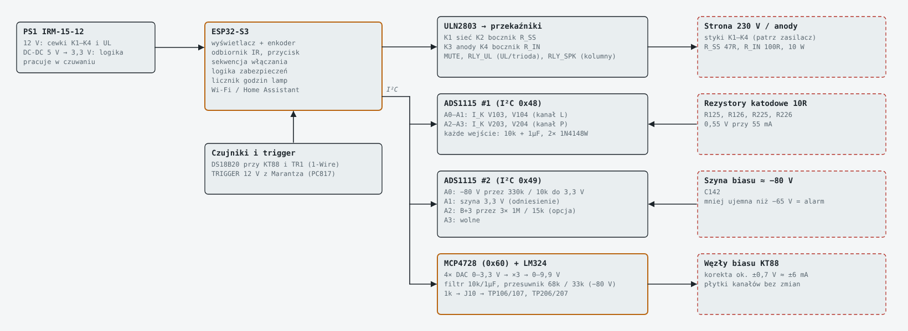
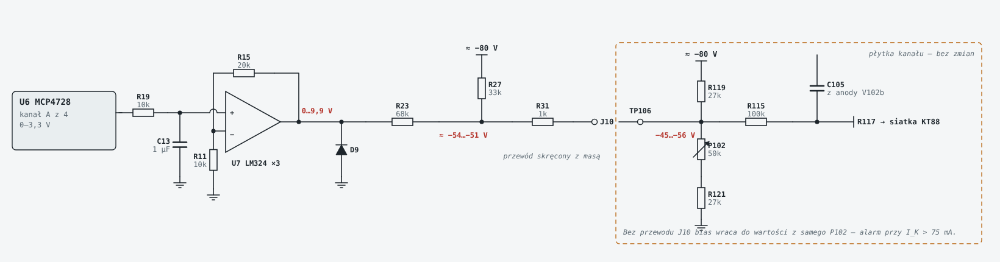
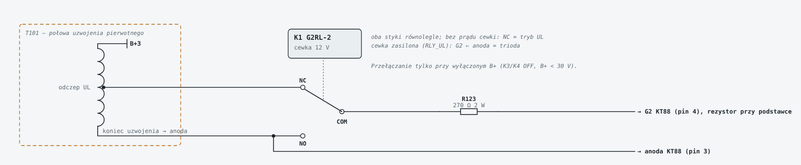

> Kopia z projektu [Soloist-KT88](https://github.com/sieraczynski-lab/Soloist-KT88) (stan 2026-11-10). Opis dotyczy Soloista; zmiany dla Williamsona (bias z płytki Onyxa, pomiar Ua, progi, zasilacz) są w [docs/09](../09-integracja-soloist.md) i [pcb/CZYTAJ_MNIE.txt](../../pcb/CZYTAJ_MNIE.txt).

# 3. Sterowanie ESP32

## Sprzęt (płytka `sterowanie`)

| Blok | Elementy | Uwagi |
|---|---|---|
| Zasilanie | Mean Well IRM-15-12 (PS1), mini przetwornica 12 → 5 V (U2), 3,3 V z modułu ESP32 | pracuje też w czuwaniu |
| Mikrokontroler | ESP32-S3-DevKitC-1 na listwach | |
| Pomiary | 2× ADS1115 (I²C 0x48, 0x49) | prądy 4× KT88 (10 Ω w katodach), szyna biasu, B+ |
| Korekta biasu | MCP4728 (I²C 0x60) + LM324 | patrz niżej |
| Przekaźniki | ULN2803G-S18-R | K1–K4, MUTE, UL/trioda, kolumny |
| Trigger | PC817 | wejście 12 V z amplitunera |
| Użytkownik | DS18B20, TSOP38238 (IR), wyświetlacz I²C, enkoder | |

### Wyjścia ULN2803 / piny ESP32

| ULN | ESP32 | Funkcja | Złącze |
|---|---|---|---|
| 1–4 | GPIO10–13 | K1–K4 | J2 |
| 5 | GPIO14 | MUTE przedwzmacniacza | J3 |
| 6 | GPIO17 | RLY_UL (4 przekaźniki UL/trioda) | J11 |
| 7 | GPIO18 | RLY_SPK (przełącznik kolumn) | J13 |
| — | GPIO1 | TRIG_IN (0 = trigger aktywny) | J12 |
| — | GPIO8 / GPIO9 | SDA / SCL | |

Piny strapping (GPIO0, 3, 45, 46) są nieużywane.

## Sekwencja włączania

| Krok | Czas | ESP32 robi | Warunek |
|---|---|---|---|
| Czuwanie | — | czeka na przycisk, IR albo trigger | |
| Sieć | t = 0 | K1 ON (TR1 przez R_SS) | |
| Bocznik | +1,5 s | K2 ON | |
| Kontrola biasu | +2…5 s | mierzy szynę | −68…−92 V, inaczej błąd i K1 OFF |
| Nagrzewanie | do +45 s | odlicza | bias w normie |
| Anody | +45 s | K3 ON, potem K4 | |
| Stabilizacja | +46…90 s | czyta IK | każda lampa 35–75 mA, stabilna 5 s |
| Gra | ok. +60 s | zdejmuje MUTE | |
| Kolumny na Lampę | po stabilizacji | MUTE → RLY_SPK ON → 0,5 s → MUTE OFF | do tego czasu kolumny grają z Marantza |
| Wyłączanie | — | MUTE → RLY_SPK OFF → K3/K4 OFF → 3 s → K1/K2 OFF | |

## Zabezpieczenia programowe

| Warunek | Reakcja |
|---|---|
| Szyna biasu mniej ujemna niż −65 V | MUTE, K3/K4 OFF |
| Średni IK > 130 mA przez 3 s | K3/K4 OFF |
| IK spoczynkowy > 75 mA (cisza, 5 s) | K3/K4 OFF (chroni m.in. przed przerwanym przewodem korekty) |
| IK < 20 mA przy pozostałych w normie | ostrzeżenie: brak żarzenia / zużyta lampa |
| Różnica w parze > 10 mA | ostrzeżenie: wyreguluj potencjometr |
| DAC korekty na końcu zakresu | ostrzeżenie: lampa do wymiany / przestaw potencjometr |
| Temperatura > 70 °C / > 80 °C | ostrzeżenie / wyłączenie anod |
| B+ > 50 V przy wyłączonych anodach | komunikat „HV” do czasu rozładowania |
| Każdy alarm | kolumny od razu wracają do Marantza |

## Automatyczna korekta biasu

**Dlaczego:** toroidalny transformator wyjściowy nie ma szczeliny w rdzeniu, więc różnica prądów stałych w parze KT88 podmagnesowuje rdzeń: rosną zniekształcenia w basie i przydźwięk. Lampy rozjeżdżają się z czasem, a ręczne kręcenie potencjometrem co miesiąc jest uciążliwe.

**Jak działa:**
- Potencjometry P102/P103 ustawiają bias zgrubnie, automat dodaje tylko poprawkę.
- Tor: MCP4728 → filtr 10k / 1 µF → LM324 ×3 (0–9,9 V) → przesuwnik poziomu 68k / 33k do szyny biasu → 1k → J10 → punkty pomiarowe TP106/TP107 na płytce kanału.
- **Płytka kanału bez zmian**: przewody z J10 lutujesz do punktów pomiarowych (przewód skręcony z masą).
- Zakres korekty: ok. **±0,7 V na siatce, czyli ok. ±6 mA**.
- Zakres potencjometru z dołączoną korektą: −45…−56 V (bez niej −40…−59 V).

**Bezpieczeństwo:**
- awaria ESP32 albo LM324 przesuwa bias najwyżej o ok. 0,85 V;
- przy braku 12 V diody D9–D12 trzymają wyjście LM324 przy masie, a bias idzie ok. 0,8 V na chłodniej;
- po włączeniu MCP4728 ładuje wartość z EEPROM (fabrycznie 0 V, czyli najchłodniej);
- **przerwany przewód J10** przy potencjometrze skręconym do końca daje do 4,5 V cieplej, dlatego jest alarm 75 mA w ciszy. Po zmianie R119/R120 na 20k (propozycja) będzie to tylko 2,1 V.

**Algorytm (do napisania):**
1. koryguj tylko w ciszy: prądy stabilne przez 30–60 s, bez sygnału, bo w klasie AB średni prąd rośnie z muzyką;
2. małymi krokami: najpierw wyrównaj parę (różnica < 1 mA), potem dociągnij do 55 mA;
3. zapamiętuj ustawienia, przy włączeniu startuj z ostatnich wartości;
4. DAC na końcu zakresu → komunikat „lampa do wymiany / przestaw potencjometr”.

**Uruchomienie:** DAC na połowę zakresu (ok. 1,65 V na wyjściu MCP4728), przy **podłączonym J10** ustaw potencjometrami ok. 55 mA na lampę, dopiero potem włącz automat.

Do ustalenia z Toroidy.pl: dopuszczalna różnica prądów stałych w parze (ΔI) dla TTG-KT88PP. Od niej zależą progi w programie.

## Przełącznik UL / trioda

- Płytka `ul` (74 × 48 mm, 2 sztuki), jedna na kanał, na dnie między KT88 danego kanału.
- Na każdą KT88 jeden Omron G2RL-2, oba styki równolegle:
  - wspólny styk idzie do G2 przez R123/R124 (270 Ω 2 W przy podstawce);
  - NC do odczepu UL, NO do anody.
- Bez prądu w cewce jest tryb UL (normalny), cewka zasilona daje triodę (ok. 20–25 W).
- **Przełączanie tylko przy wyłączonym B+:** MUTE → K3/K4 OFF → czekaj na B+ < 30 V → RLY_UL → anody jak przy starcie. W chwili przeskoku styku G2 na moment wisi w powietrzu.
- Przekaźniki nie zmieściły się na płytce kanału. Nie są też na zasilaczu ani na sterowaniu, bo przez styki płynie sygnał z anod (do ok. 850 V szczytowo).
- Po przełączeniu na triodę sprawdź prostokątem stabilność (zmienia się wzmocnienie pętli).

## Przełącznik kolumn Marantz / Lampa

- Płytka `glosniki` (100 × 42 mm) leży na dnie pod lewym transformatorem głośnikowym.
- Na kanał jeden G2RL-2, przełączane **oba bieguny**, więc wyjścia Marantza i Lampy nigdy nie są połączone:
  - wspólny styk do kolumny;
  - NC do Marantza;
  - NO do wyjścia 4 Ω Lampy.
- **Bez prądu w cewkach kolumny grają z Marantza**, także gdy Lampa jest wyłączona albo nie działa ESP32.
- Lampa przejmuje kolumny tylko po stabilizacji i przy MUTE. R127 zostaje na wtórnym, więc lampa nigdy nie gra bez obciążenia. Sprzężenie zwrotne jest brane sprzed przekaźnika.
- Styki 8 A wystarczą: Lampa daje ok. 3,4 A przy 45 W / 4 Ω, Marantz ok. 5 A przy 100 W / 4 Ω.
- Tylna ścianka ma 4 pary zacisków: górny rząd z Marantza, dolny do kolumn.

## Wejście TRIGGER 12 V

- Marantz SR7013 ma wyjście TRIGGER OUT (jack 3,5 mm), które podaje 12 V, gdy amplituner jest włączony albo gdy wybrane jest przypisane wejście lub strefa.
- Na tylnej ściance Lampy jest gniazdo jack 3,5 mm mono z **plastikowym korpusem**. Tulejka nie może dotykać obudowy, inaczej masy Marantza i Lampy połączą się przez obudowę.
- Sygnał idzie przez J12 → R35 1k → transoptor PC817 (U8), zabezpieczony diodą D13 przed odwrotną polaryzacją. Masa Marantza jest oddzielona od masy Lampy.
- Na wejściu ESP32 (GPIO1) jest TRIG_IN = 0, gdy trigger aktywny.
- Pojawienie się 12 V włącza Lampę i wybiera wejście pre-out (tryb kina domowego, stała głośność). Zanik 12 V wyłącza Lampę i oddaje kolumny Marantzowi.
