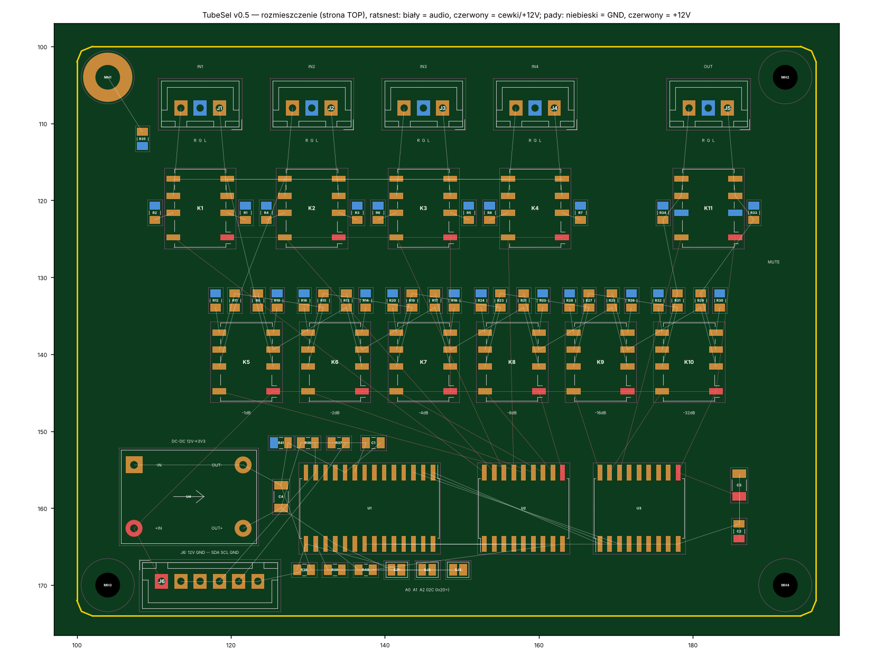

# Selektor wejść + przekaźnikowa regulacja głośności (TubeSel)

Płytka z projektu Soloist 88, w Williamsonie bez zmian: **4 wejścia stereo**, **drabinka przekaźnikowa 0–63 dB co 1 dB** (stała impedancja ok. 10 kΩ, rezystory 0,1%), **mute fail-safe**. Przekaźniki sygnałowe Omron G6K-2F-Y, sterowanie po I²C (MCP23017 + 2× ULN2803) z ESP32-S3 płytki sterowania, zasilanie tylko 12 V.

Status: **v0.5**: schemat gotowy, elementy rozmieszczone, ścieżki do poprowadzenia.

## Struktura

| Folder | Zawartość |
|---|---|
| [`docs/soloist/11-selektor.md`](../../docs/soloist/11-selektor.md) | **Pełna dokumentacja**: decyzje projektowe, drabinka, sterowanie, integracja z płytką sterowania, masy i ekranowanie, dopasowanie do EF86, firmware, zakupy, montaż, otwarte punkty |
| [`kicad/`](kicad/) | Projekt KiCad 8/9 + BOM-y (`BOM.csv`, `JLCPCB_BOM.csv`, `LCSC_zamowienie.csv`) |
| [`kicad5-easyeda/`](kicad5-easyeda/) | Ten sam projekt w formacie KiCad 5.1 do importu w EasyEDA Pro |
| [`narzedzia/selektor/`](../../narzedzia/selektor/) | Skrypty generujące, weryfikujące i eksportujące projekt (Python); `eksport.py` robi pliki poniżej |
| `selektor_BOM.csv`, `selektor_netlista.csv`, `selektor_klasy_sieci.csv`, `selektor_rozmieszczenie.png/.svg`, `selektor_rozmieszczenie_1do1.pdf`, `selektor_schemat.png` | Ten sam komplet plików co przy pozostałych płytkach |
| `selektor_BOM_JLCPCB.csv`, `selektor_CPL_JLCPCB.csv` | Montaż SMD w JLCPCB: BOM i pozycje elementów (po trasowaniu w EasyEDA lepiej wziąć CPL wygenerowany przez EasyEDA) |
| `selektor_BOM_LCSC.xlsx` | Części z LCSC na 1 płytkę, z zapasem |
| `import_EasyEDA/` | `selektor_EasyEDA_Pro_KiCad5.zip` (EasyEDA Pro: Import > KiCad), `selektor_KiCad8.zip` (KiCad 8/9). Wersji dla EasyEDA Standard (KiCad 4) nie ma |

## Najważniejsze w skrócie

- Przypisanie MCP23017: GPA0–3 = wejścia 1–4, GPA4–GPB1 = bity −1…−32 dB, GPB2 = mute (1 = dźwięk). Adres 0x20 (zworki SJ1–SJ3).
- J6 do ESP32 (JST XH 6p): +12 V, DGND, n/c, SDA, SCL, DGND.
- Zmiana głośności: najpierw załącz nowe bity, ok. 5 ms, potem wyłącz zbędne.
- Po starcie drabinka stoi na 0 dB (pełna głośność) przy aktywnym mute: ustaw głośność przed zdjęciem mute.
- Limity głośności dla każdego wejścia: [docs/09, 9.9](../../docs/09-integracja-soloist.md) (czułość Williamsona ok. 0,65 V).
- Do decyzji: MUTE z płytki sterowania przez J6 pin 3 ([docs/soloist/11, rozdz. 7.5](../../docs/soloist/11-selektor.md)).
